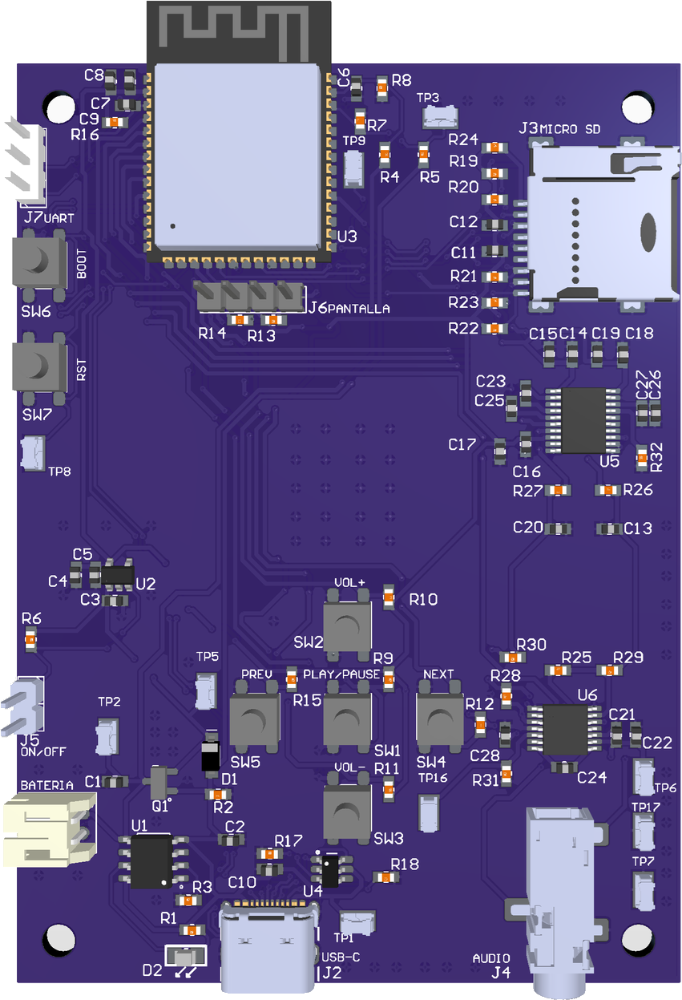
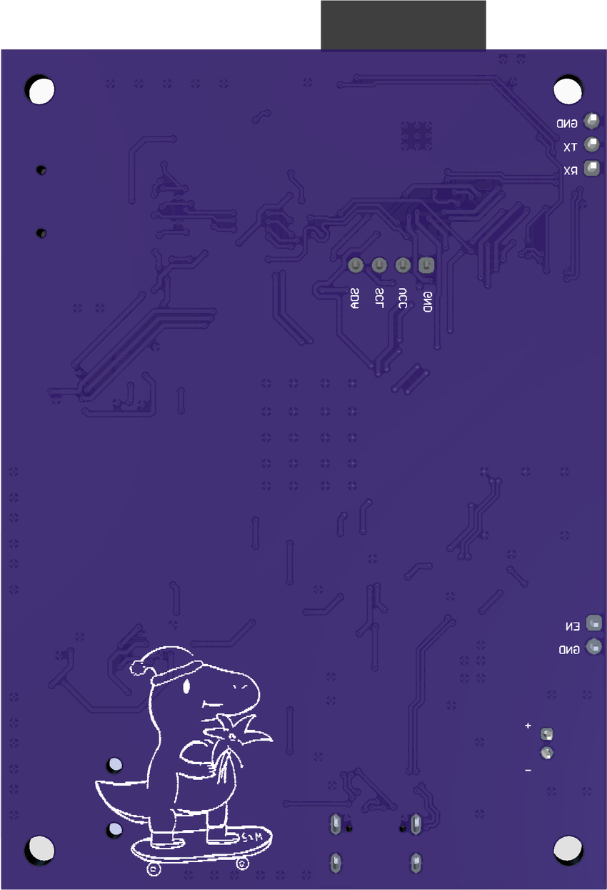

# Reproductor MP3 portátil sin distracciones

**Sistemas embebidos · Diseño electrónico · ESP-IDF · C**

<p align="center">
  
  &nbsp;&nbsp;
  
</p>
<p align="center"><i>PCB Rev A: renders 3D de Altium Designer, cara superior e inferior (la placa aún no está fabricada).</i></p>

Proyecto del curso de Diseño Electrónico (Universidad Nacional de Colombia, Sede Manizales): un reproductor de música dedicado y sin conexión. Reproduce archivos MP3 desde una microSD, se controla con botones físicos y no depende del celular, de internet ni de servicios de streaming.

> **Estado final (noviembre 2026):**
> - **PCB Rev A:** diseño congelado y entregado (etiqueta `rev-a`), con ERC sin errores y DRC sin violaciones. **No está fabricada**, así que el hardware propio no está validado.
> - **Firmware:** validado en una prueba de concepto (PoC) sobre la placa de desarrollo ESP32-S31-Korvo-1. Reproduce MP3 desde la microSD, se controla con botones (play/pausa, siguiente/anterior, volumen con tope), muestra la interfaz de 128×64 y hace un apagado ordenado por batería baja simulada.

## Documentos principales

| Documento | Contenido |
| --- | --- |
| **[Nota de aplicación (PDF)](docs/nota-aplicacion/Nota_de_Aplicacion_Reproductor_MP3.pdf)** · [versión Markdown](docs/nota-aplicacion/NOTA_APLICACION.md) | Diseño completo: arquitectura, cálculos de energía y audio, esquemáticos, layout, firmware y resultados de la PoC |
| **[Presentación final (PDF)](docs/presentacion/Presentacion_Final_Reproductor_MP3.pdf)** | Presentación de 6 minutos: problema, especificaciones, decisiones de diseño, nota de aplicación y documentación |
| [Pitch del producto (PDF)](docs/pitch/Pitch_Reproductor_MP3.pdf) | Presentación tipo pitch (necesidad, solución, costo y competencia) |
| [Manual de conexiones Rev A](hardware/docs/MANUAL_CONEXIONES_RevA.md) | Conectores, mapa de GPIO, botones y puntos de prueba |
| [Presupuesto de potencia](hardware/docs/POWER_BUDGET_REV_A.md) | Consumo estimado y autonomía de la batería |
| [Estado de la PoC](poc/esp32-s31-korvo-1/docs/POC_STATUS.md) | Evidencia, logs y límites de la prueba de concepto |

## Arquitectura del hardware (PCB Rev A)

| Bloque | Diseño Rev A |
| --- | --- |
| Microcontrolador | ESP32-S3-WROOM-1-N16R8 |
| Audio | DAC I²S PCM5102A → filtro RC → amplificador de audífonos TPA6138A2 → jack de 3.5 mm |
| Almacenamiento | microSD por SPI, con detección de tarjeta |
| Interfaz | Pantalla OLED SSD1306 de 128×64 (I²C) y cinco botones |
| Energía | Li-Po 1S, cargador TP4056, selección de fuente (AP2301 + Schottky), LDO AP2112K de 3.3 V |
| USB | USB-C 2.0 (alimentación y datos) con protección ESD USBLC6; USB MSC como trabajo futuro |

Placa de 2 capas, 65 × 90.17 mm, pensada para JLCPCB y para soldar a mano. Detalles en **[hardware/README.md](hardware/README.md)**.

**Diferencia importante entre plataformas:** la ESP32-S31-Korvo-1 es una placa temporal de prueba. Usa un ESP32-S31, el códec ES8389 y almacenamiento SDMMC. Sus resultados validan el firmware (lógica, formatos, tiempos), **no** la electrónica de la PCB Rev A (ESP32-S3, PCM5102A/TPA6138A2, microSD por SPI).

## Qué está validado

**En la PoC (ESP32-S31-Korvo-1)**
- Montaje de la microSD y catálogo ordenado de los `.mp3` de la carpeta `MUSIC` (escenarios SD-01 a SD-07).
- Reproducción de WAV y MP3 (minimp3): una canción completa de 2:53 sin cortes; decodificación de 2.8 ms en promedio por frame de 24 ms.
- Reproductor con botones, volumen limitado a −12 dB y secuencia anti-*pop*.
- Interfaz de 128×64 mostrada como "OLED virtual" en la pantalla de la Korvo, con apagado tras 10 s.
- Apagado ordenado por batería baja simulada.
- Videos de las pruebas: [enlace público](https://drive.google.com/drive/folders/17f_VWlQ8yTDR5UOtKaLUpxXInd0uO0in?usp=drive_link) · [enlace institucional](https://drive.google.com/drive/folders/1Tq-jJcRcQZm7ZzIBcm1W4Nzm8Wph00uq?usp=sharing) (requiere cuenta @unal.edu.co).

**En el computador:** pruebas del catálogo, del lector WAV, del decodificador MP3, del núcleo del reproductor y de la interfaz.

**Sin validar:** la PCB fabricada, el consumo y la autonomía reales, la medición real de la batería, USB MSC y frecuencias de muestreo distintas de 8, 16, 44.1 y 48 kHz en la Korvo (limitación de su códec).

## Estructura del repositorio

```text
docs/
├── nota-aplicacion/      # Nota de aplicación: PDF, Markdown, imágenes y fuente para regenerarla
├── presentacion/         # Presentación final (6 minutos) en PDF
└── pitch/                # Presentación tipo pitch en PDF
hardware/
├── altium/
│   ├── MP3_Player/       # Proyecto de Altium: 7 hojas de esquemático y la PCB
│   └── libraries/        # Librería propia (MP3_RevA)
├── docs/                 # Manual de conexiones, presupuesto de potencia y plan de trabajo
└── outputs/
    └── MP3_entregables/  # Gerbers, BOM, esquemático en PDF, Draftsman y 3D
poc/
└── esp32-s31-korvo-1/
    ├── main/             # Firmware de la PoC: núcleo portable y capa de placa
    ├── tests/host/       # Pruebas que corren en el computador
    ├── docs/             # Estado, validación y evidencia
    └── tools/            # Utilidades de desarrollo
```

## Versiones

- `rev-a`: diseño de la PCB entregado (15 de noviembre de 2026).
- `v1.0-entrega-final`: cierre del proyecto con la nota de aplicación y el pitch.
- `v1.1-presentacion-final`: presentación final de 6 minutos y enlace público a los videos de la PoC.

## Trabajo futuro

1. Fabricar y ensamblar la Rev A, y hacer el primer encendido con los puntos de prueba.
2. Escribir la capa de placa del ESP32-S3: microSD por SPI, PCM5102A con `XSMT` y `AMP_MUTE_N`, cinco botones (según la tabla de la nota de aplicación, sección 3.6), SSD1306 y lectura real de la batería.
3. Medir consumo, autonomía y temperatura del regulador.
4. Transferir canciones por USB (MSC); opcionalmente, por Wi-Fi.
5. Rev B: renombrar las redes de los botones para que coincidan con la serigrafía.

## Licencia

GPLv3. Ver [LICENSE](LICENSE).
