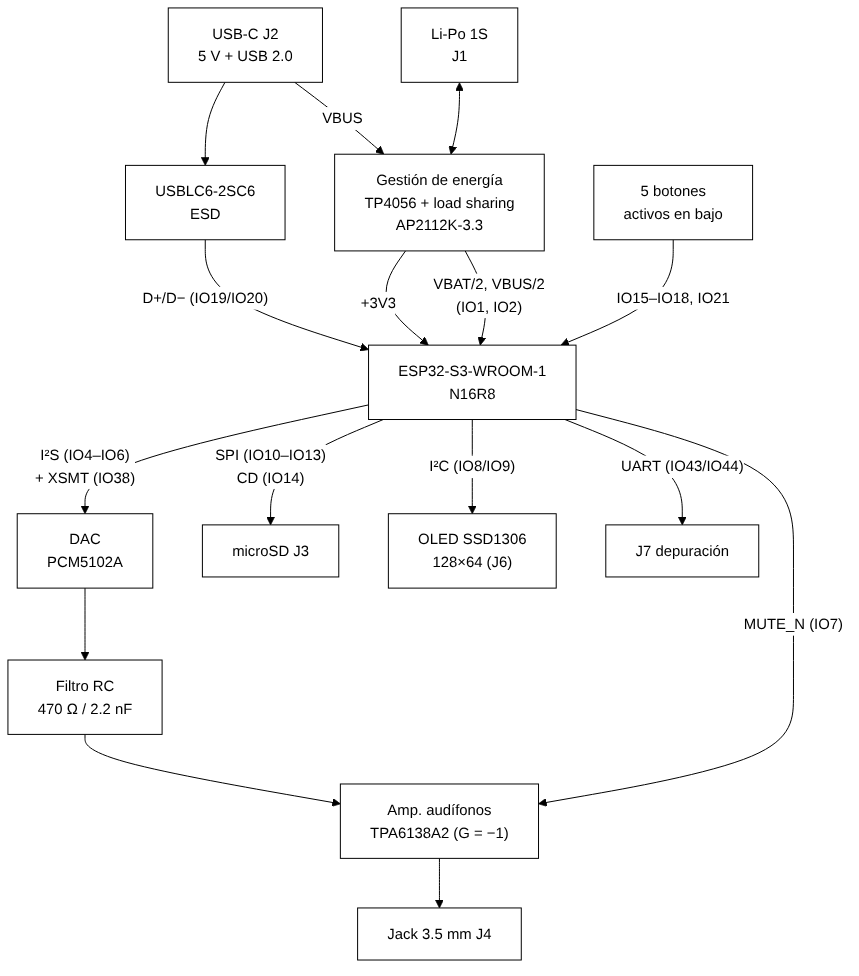
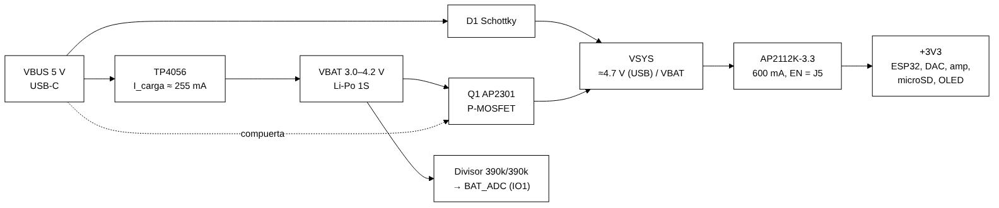
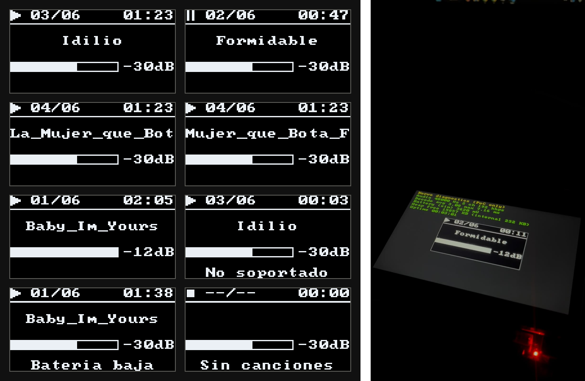
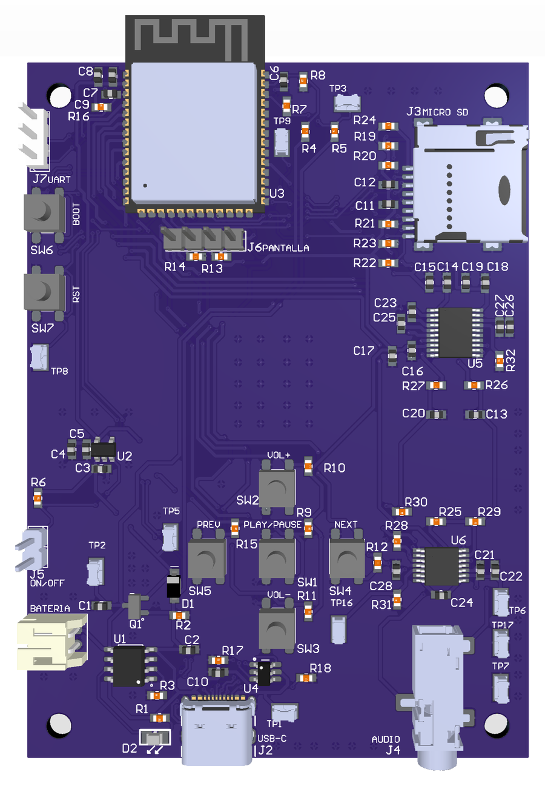
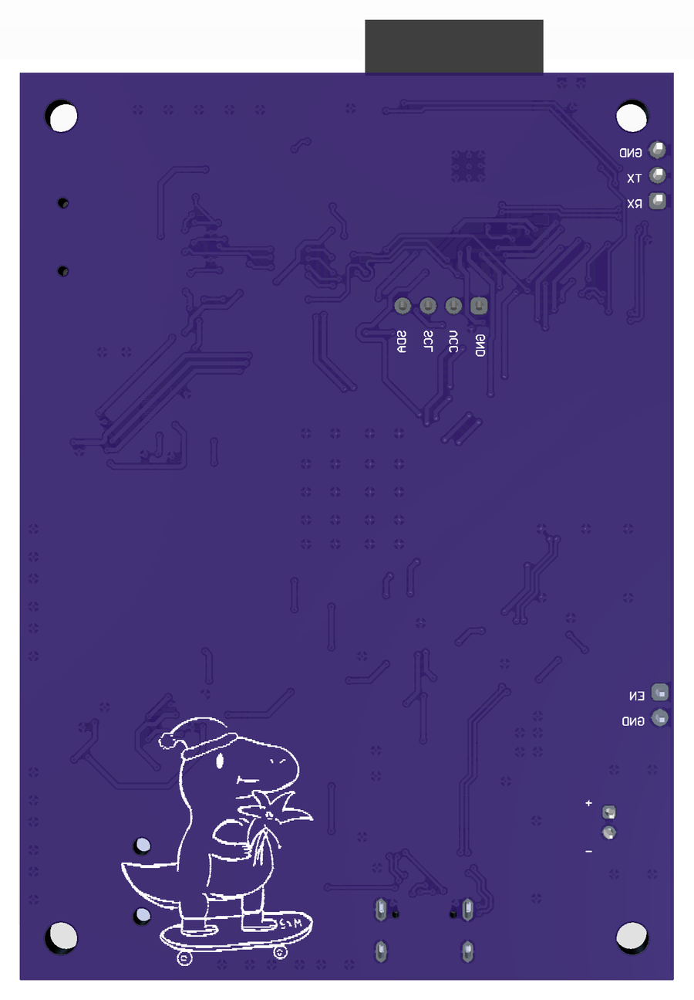
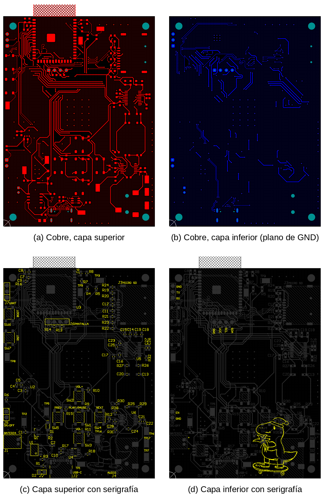
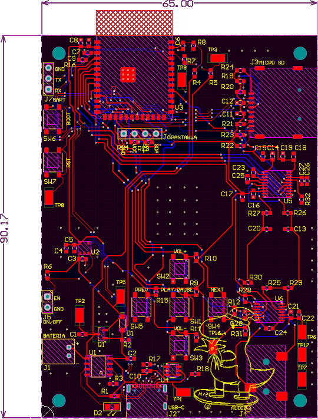

# Nota de aplicación MP3-AN-001: Reproductor MP3 portátil sin distracciones con ESP32-S3, DAC PCM5102A y amplificador de audífonos TPA6138A2

<!-- cover-start -->

## Descripción

Esta nota de aplicación describe el diseño de referencia de un reproductor de música portátil, autónomo y sin conexión, que reproduce archivos MP3 desde una tarjeta microSD y entrega el audio por un jack de 3.5 mm para audífonos. El sistema se construye alrededor de un módulo ESP32-S3-WROOM-1-N16R8, un DAC estéreo I²S PCM5102A y un amplificador de audífonos TPA6138A2, alimentados por una batería Li-Po de una celda que se carga por USB-C.

La PCB Rev A está diseñada y entregada, pero aún no está fabricada. Los valores de la PCB son cálculos a partir de los datasheets; los resultados medidos provienen de una prueba de concepto del firmware en una placa de desarrollo.

## Recursos

| Documento / componente | Tipo |
|---|---|
| MP3_Electronic_Design | Repositorio del proyecto |
| ESP32-S3-WROOM-1-N16R8 | Microcontrolador |
| PCM5102A | DAC de audio |
| TPA6138A2 | Amplificador de audífonos |
| AP2112K-3.3 | Regulador LDO |
| TP4056 | Cargador Li-Po |

## Características

- Decodificación de MP3 en el propio microcontrolador con minimp3 (dominio público).
- DAC de 32 bits sin reloj maestro externo y amplificador con salida centrada en tierra, sin capacitores de acople.
- Secuencia anti-*pop* por firmware con dos pines de silencio: `DAC_XSMT` y `AMP_MUTE_N`.
- Volumen limitado a −12 dB para no saturar la etapa de salida.
- Carga por USB-C, selección automática de fuente y medición de la batería por ADC.
- Corte ordenado por batería baja.
- Cinco botones y pantalla OLED SSD1306 de 128×64 por I²C.
- PCB de 2 capas, 65 × 90.17 mm, ensamblable a mano.

## Aplicaciones

- Reproductor de música personal sin distracciones
- Audio digital embebido con ESP32-S3
- Proyectos académicos de audio de bajo consumo

<!-- cover-end -->

# 1 Descripción del sistema

> **NOTA:** La PCB Rev A está diseñada y entregada (ERC con 0 errores, DRC con 0 violaciones), pero **aún no está fabricada**. Los valores de la PCB son **cálculos y estimaciones a partir de los datasheets**, señalados como tales. Los **resultados medidos** provienen de una prueba de concepto (PoC) del firmware en una placa de desarrollo de Espressif, la ESP32-S31-Korvo-1, que valida la lógica, los formatos, los tiempos y los protocolos, pero **no** la electrónica de la PCB. Las imágenes de la PCB son **renders 3D de Altium Designer**, no fotografías.

El objetivo del producto es ofrecer una experiencia de escucha sencilla, basada en contenido local y controles físicos, sin teléfono, sin internet y sin servicios de streaming. El usuario copia sus canciones en una microSD, las recorre con cinco botones y ve la pista actual en una pantalla OLED pequeña.

## 1.1 Especificaciones clave

| Parámetro | Valor | Origen |
|---|---|---|
| Microcontrolador | ESP32-S3-WROOM-1-N16R8 (2 núcleos Xtensa LX7, 16 MB de flash, 8 MB de PSRAM) | Datasheet Espressif |
| Formato de audio | MP3 desde microSD FAT32, carpeta `/MUSIC` | Requisito V1 |
| Frecuencias de muestreo | 8–48 kHz admitidas por el decodificador; el PCM5102A acepta de 8 a 384 kHz | Firmware / datasheet TI |
| Salida | Jack estéreo de 3.5 mm para audífonos | Esquemático |
| Potencia de salida | ≈ 25 mW por canal en 32 Ω (límite del TPA6138A2); ≈ 8.7 mW con el tope de −12 dB | Datasheet TI / cálculo (sección 3.3) |
| Almacenamiento | microSD por SPI, con detección de tarjeta | Esquemático |
| Interfaz | 5 botones activos en bajo + OLED SSD1306 128×64 I²C | Esquemático |
| Alimentación | Li-Po 1S de 3.0–4.2 V; USB-C de 5 V | Esquemático |
| Corriente de carga | ≈ 255 mA (R_PROG = 4.7 kΩ) | Cálculo (sección 3.1) |
| Consumo estimado reproduciendo | ≈ 110–120 mA con pantalla encendida; ≈ 85–95 mA con pantalla apagada | Presupuesto de potencia, no medido |
| Autonomía estimada | ≈ 7.5 h con 1000 mAh; ≈ 9 h con 1200 mAh | Presupuesto de potencia, no medido |
| PCB | 2 capas, FR-4 de 1.6 mm, cobre de 1 oz, 65 × 90.17 mm | Altium |

# 2 Visión general del sistema

## 2.1 Diagrama de bloques

El ESP32-S3 concentra todo el procesamiento: lee los archivos de la microSD por SPI, decodifica el MP3 y envía las muestras PCM al DAC por I²S. El DAC convierte la señal a analógica, un filtro RC elimina el ruido fuera de banda y el amplificador entrega la señal a los audífonos. Los botones y la pantalla completan la interfaz, y el bloque de energía alimenta todo desde la batería o desde el USB-C.

## 2.2 Asignación de pines del ESP32-S3

| Función | GPIO | Notas |
|---|---|---|
| I²S BCK / LRCK / DIN | IO4 / IO5 / IO6 | Audio digital hacia el PCM5102A |
| `AMP_MUTE_N` | IO7 | Silencio del amplificador; pull-down de 100 kΩ: arranca en silencio |
| `DAC_XSMT` | IO38 | Silencio suave del DAC; pull-down de 10 kΩ: arranca en silencio |
| OLED SDA / SCL | IO8 / IO9 | I²C, pull-ups de 4.7 kΩ |
| SD CS / MOSI / SCK / MISO | IO10 / IO11 / IO12 / IO13 | SPI, pull-ups de 10 kΩ |
| `SD_CD_N` | IO14 | 0 V = tarjeta presente |
| Botones PLAY, VOL+, VOL−, NEXT, PREV | IO15, IO16, IO17, IO18, IO21 | Activos en bajo, pull-up de 10 kΩ; función según serigrafía (Tabla 7) |
| `BAT_ADC` / `VBUS_DET` | IO1 / IO2 | Divisores ½ de la batería y del USB |
| USB D− / D+ | IO19 / IO20 | USB nativo: programación, monitor serie y USB MSC a futuro |
| UART TX / RX | IO43 / IO44 | Header de depuración J7 |

Los pines de arranque (IO3, IO45, IO46) se dejan libres a propósito, e IO35–IO37 no se conectan porque los usa internamente la PSRAM octal del módulo N16R8.

## 2.3 Componentes destacados

| Componente | Función | Por qué se eligió |
|---|---|---|
| **ESP32-S3-WROOM-1-N16R8** (Espressif) | MCU, decodificación MP3, USB nativo | 19 señales de periféricos más USB: la alternativa del curso (ESP32-C3) deja solo 13 GPIO libres. Doble núcleo y 8 MB de PSRAM dan margen para el decodificador y la interfaz |
| **PCM5102A** (Texas Instruments) | DAC estéreo I²S | Se configura solo con pines (sin I²C) y genera su reloj interno a partir de BCK, así que no necesita MCLK. Salida de 2.1 Vrms centrada en tierra |
| **TPA6138A2** (Texas Instruments) | Amplificador de audífonos | Salida DirectPath centrada en tierra: no necesita capacitores de acople grandes. Ganancia fijada con resistencias externas y pin `MUTE_N` para el anti-pop |
| **AP2112K-3.3** (Diodes Inc.) | Regulador LDO de 3.3 V | Caída de ≈ 250 mV a 600 mA, pin EN y ≈ 55 µA de consumo en reposo. El AMS1117 de la librería del curso necesita ≈ 1.1 V de caída y no regularía con la batería |
| **TP4056** | Cargador Li-Po lineal | Disponible en la librería del curso; corriente de carga ajustable con una resistencia |
| **AP2301 + Schottky** | Selección de fuente (*load sharing*) | Con USB, el sistema se alimenta del USB y la batería solo carga (Microchip AN1149) |
| **USBLC6-2SC6** (ST) | Protección ESD de D+/D− | Protege el USB nativo del ESP32 |
| **SSD1306** (módulo de 0.96") | Pantalla OLED 128×64 | Monocromo, bajo consumo y bus I²C de dos hilos |

# 3 Teoría y consideraciones de diseño

## 3.1 Gestión de energía

**Carga.** El TP4056 fija la corriente de carga con la resistencia R_PROG:

$$I_{carga} = \frac{1200\ \text{V}}{R_{PROG}} = \frac{1200\ \text{V}}{4.7\ \text{k}\Omega} \approx 255\ \text{mA}$$

Es una corriente conservadora (≈ 0.25 C para una batería de 1000 mAh), que cuida la celda y reduce la disipación del cargador lineal. Una carga completa de 1000 mAh tarda ≈ 4.5–5 h, incluida la etapa final a voltaje constante. El pin CHRG enciende un LED mientras carga.

**Selección de fuente.** Sin USB, el P-MOSFET Q1 (AP2301) conduce y conecta la batería a `VSYS`. Al conectar el USB, su compuerta sube a 5 V, Q1 se apaga y el sistema pasa a alimentarse del USB a través del diodo Schottky D1, mientras el TP4056 carga la batería sin compartir su corriente con la carga del sistema. R2 (49.9 kΩ) descarga la compuerta al desconectar el USB, para que Q1 vuelva a conducir de inmediato.

**Regulación.** El AP2112K-3.3 entrega `+3V3` a todo el sistema. Al ser lineal, la corriente de la batería es prácticamente igual a la corriente de la carga. Su disipación, con el consumo típico de ≈ 120 mA, es:

| Condición | Vin | Disipación (Vin − 3.3 V) × I |
|---|---|---|
| Batería llena, típico | 4.2 V | ≈ 0.11 W |
| USB conectado, típico | ≈ 4.7 V | ≈ 0.17 W |
| USB conectado, pico (≈ 280 mA) | ≈ 4.7 V | ≈ 0.39 W |

El pico corresponde a ráfagas cortas de la microSD sumadas al peor caso del resto, no a un consumo sostenido. Aun así, es un punto que debe verificarse térmicamente en la placa fabricada; el cobre de los planos de GND alrededor del SOT-23-5 ayuda a disiparlo.

**Límite inferior de la batería.** Con ≈ 250 mV de caída a plena carga (menos a 120 mA), el LDO deja de regular cuando la batería baja de ≈ 3.5 V. Como el TP4056 tampoco protege contra sobredescarga, el firmware lee la batería y **apaga el sistema de forma ordenada por debajo de 3.5 V** (sección 4.3). Por la misma razón, la nota considera utilizable ≈ 85 % de la capacidad nominal.

**Medición de batería y de USB.** Dos divisores de 390 kΩ / 390 kΩ llevan la mitad de `VBAT` y de `VBUS` a los ADC del ESP32:

$$V_{BAT\_ADC} = \frac{V_{BAT}}{2} \le 2.1\ \text{V}, \qquad I_{divisor} = \frac{4.2\ \text{V}}{780\ \text{k}\Omega} \approx 5.4\ \mu\text{A}$$

El umbral de corte de 3.5 V corresponde a 1.75 V en el ADC. El capacitor C6 de 100 nF estabiliza la lectura frente a la alta impedancia del divisor (constante de tiempo ≈ 20 ms, despreciable frente a la descarga de la batería).

## 3.2 Presupuesto de potencia y autonomía

Estimación con valores típicos de los datasheets, reproduciendo con Wi-Fi y Bluetooth apagados. **No está medida.**

| Bloque | Típico | Peor caso |
|---|---|---|
| ESP32-S3 (decodificación MP3, radio apagada) | 40–60 mA | ≈ 70 mA |
| PCM5102A (3.3 V, 48 kHz) | 30 mA | 45 mA |
| TPA6138A2 (sin carga) | 14 mA | 25 mA |
| Audífonos 2 × 32 Ω | ≈ 4 mA | ≈ 20 mA |
| OLED SSD1306 | ≈ 10 mA | ≈ 20 mA |
| microSD en modo SPI | ≈ 10 mA promedio | ≈ 100 mA en ráfaga |
| LDO, divisores, pull-ups | < 0.1 mA | — |
| **Total** | **≈ 110–120 mA** | **≈ 280 mA** |

El peor caso deja más de 2× de margen frente a los 600 mA del AP2112K.

| Batería Li-Po 1S | Reproduciendo, pantalla encendida | Pantalla apagada, CPU a 160 MHz | Carga a 255 mA |
|---|---|---|---|
| 1000 mAh | ≈ 7.5 h | ≈ 9.5 h | ≈ 4.5–5 h |
| 1200 mAh | ≈ 9 h | ≈ 11 h | ≈ 5–5.5 h |
| 2000 mAh | ≈ 15 h | ≈ 19 h | ≈ 8.5–9 h |

Autonomía ≈ capacidad × 0.85 / corriente. El objetivo del proyecto era **8 horas**: con estas estimaciones se cumple a partir de ≈ 1200 mAh, o con 1000 mAh si la pantalla se apaga por inactividad, que es justo lo que hace el firmware (sección 4.3).

## 3.3 Etapa de audio

**DAC.** El PCM5102A recibe I²S estándar (FMT = 0) y genera su reloj interno a partir de BCK (SCK a GND), por lo que el ESP32 no necesita sacar MCLK. FLT y DEMP a GND seleccionan el filtro de interpolación normal y desactivan el de-énfasis. `XSMT` tiene un pull-down de 10 kΩ, así que el DAC **arranca en silencio** hasta que el firmware pone IO38 en alto. Cada pin de alimentación lleva su desacople de 100 nF + 10 µF, y la bomba de carga interna (CAPP–CAPM, VNEG) produce la salida centrada en 0 V.

**Filtro de salida.** Cada canal pasa por un paso bajo RC antes del amplificador:

$$f_c = \frac{1}{2\pi R C} = \frac{1}{2\pi \cdot 470\ \Omega \cdot 2.2\ \text{nF}} \approx 154\ \text{kHz}$$

Está muy por encima de la banda de audio (20 kHz), así que no la atenúa, y elimina el ruido de alta frecuencia que deja el modulador del DAC antes de que llegue al amplificador.

**Amplificador.** El TPA6138A2 está en configuración inversora con Rin = Rf = 10 kΩ:

$$G = -\frac{R_f}{R_{in}} = -\frac{10\ \text{k}\Omega}{10\ \text{k}\Omega} = -1\ (0\ \text{dB})$$

Como ambos chips tienen salida centrada en tierra, la señal llega al jack sin capacitores de acople, sin perder graves y sin el escalón de continua que produce un "pop" al conectar. `MUTE_N` tiene un pull-down de 100 kΩ, así que el amplificador también arranca en silencio.

**Tope de volumen.** Con ganancia unitaria, el DAC a escala completa (2.1 Vrms) pediría a unos audífonos de 32 Ω:

$$P = \frac{V^2}{R_L} = \frac{(2.1\ \text{V})^2}{32\ \Omega} \approx 138\ \text{mW}$$

pero el TPA6138A2 alimentado a 3.3 V entrega del orden de 25 mW. El nivel que corresponde a 25 mW es:

$$V = \sqrt{P R_L} = \sqrt{0.025 \cdot 32} \approx 0.89\ V_{rms} \Rightarrow 20\log_{10}\frac{0.89}{2.1} \approx -7.4\ \text{dB}$$

El firmware limita el volumen digital a **−12 dB**, lo que da ≈ 0.53 Vrms y ≈ 8.7 mW por canal: unos 4.6 dB de margen bajo el recorte, suficientes para escuchar con comodidad. Como el PCM5102A no tiene control de volumen, este se aplica escalando las muestras en el firmware.

**Secuencia anti-pop.** Al iniciar la reproducción: arrancar el reloj I²S → esperar a que el DAC se estabilice → soltar `DAC_XSMT` → soltar `AMP_MUTE_N`. Al pausar o apagar, el orden inverso. Los pull-downs garantizan que, mientras el firmware no actúe (arranque, reinicio, pérdida de alimentación), ambos chips estén en silencio.

## 3.4 Almacenamiento microSD

La microSD se conecta por SPI con pull-ups de 10 kΩ en CS, MOSI y MISO, y también en DAT1 y DAT2, que no se usan en este modo pero no deben quedar flotando. El socket GCT MEM2075 tiene contacto de detección: `SD_CD_N` = 0 V indica tarjeta presente.

El ancho de banda necesario es pequeño: un MP3 de 320 kbps, el máximo del formato, consume 40 kB/s. Un bus SPI de 20 MHz ofrece del orden de 2.5 MB/s teóricos, más de 50 veces lo necesario. En la PoC, leer un bloque de 4 KB tardó como máximo 2.9 ms (sección 5).

## 3.5 USB-C y protección

R17 y R18 (4.7 kΩ a GND, una por cada CC) identifican la placa como dispositivo (*sink*), y cualquier cargador USB-C entrega 5 V. Las dos filas de D+/D− del conector reversible se unen, y el USBLC6-2SC6 protege las líneas de datos contra descargas electrostáticas. Las líneas de datos van al USB nativo del ESP32 (IO19/IO20): sirven para programar, para el monitor serie y, a futuro, para transferir canciones como unidad de almacenamiento (USB MSC).

## 3.6 Interfaz de usuario

Los cinco botones son activos en bajo con pull-up de 10 kΩ. No llevan capacitor: el antirrebote se hace por firmware. Su función la asigna el firmware, no el hardware: el firmware tiene una tabla que relaciona cada GPIO con la acción de la etiqueta de serigrafía que está junto al botón.

> **NOTA:** en la Rev A los nombres de red de los botones no coinciden con la serigrafía. Los designadores se ubicaron para formar la cruz y las redes quedaron cruzadas respecto a las etiquetas. Eléctricamente no hay ningún error: cada botón llega a un GPIO distinto con su pull-up. La función se corrige en firmware según la posición física, y los nombres de red se corregirán en la Rev B.

| Posición | Botón | Serigrafía | Red (Rev A) | GPIO | Función |
|---|---|---|---|---|---|
| Centro | SW1 | PLAY/PAUSE | `BTN_UP_N` | IO15 | Play/pausa |
| Arriba | SW2 | VOL+ | `BTN_DOWN_N` | IO16 | Volumen + |
| Abajo | SW3 | VOL− | `BTN_PLAY_N` | IO17 | Volumen − |
| Derecha | SW4 | NEXT | `BTN_PREV_N` | IO18 | Siguiente |
| Izquierda | SW5 | PREV | `BTN_NEXT_N` | IO21 | Anterior |
 La OLED es un módulo externo en un header de 4 pines (GND–VCC–SCL–SDA) con pull-ups I²C de 4.7 kΩ a 3.3 V en la placa, lo que también evita que un módulo con pull-ups a 5 V eleve las líneas por encima del nivel del ESP32.

## 3.7 Evolución del diseño

La arquitectura cambió durante el semestre. La tabla resume las decisiones de la propuesta de octubre (Rev. 0.3–0.5) frente a la PCB entregada.

| Bloque | Propuesta inicial | PCB Rev A | Razón técnica del cambio |
|---|---|---|---|
| Audio | Códec ES8388 | DAC PCM5102A + TPA6138A2 | El PCM5102A no necesita configuración por I²C ni MCLK, y el amplificador dedicado da salida de audífonos centrada en tierra |
| Bluetooth | Módulo BM83 (A2DP), prioridad *Should* sujeta a una PoC | No incluido | La PoC de Bluetooth era requisito para incluirlo y no se realizó; el jack era la salida obligatoria |
| Cargador | MCP73871 (power path integrado) | TP4056 + *load sharing* discreto | Criterio del curso de usar primero la librería del profesor, que incluye el TP4056 y el AP2301 |
| Regulación | Buck-boost TPS63802 | LDO AP2112K-3.3 | Menos componentes y sin conmutación junto al audio. A cambio, no regula por debajo de ≈ 3.5 V, lo que se compensa con el corte por firmware |
| Batería | 2000 mAh | Sin fijar; tabla de autonomía | Se elegirá con la carcasa; ≥ 1200 mAh cumple 8 h |
| Wi-Fi | Fuera de V1 | Sin cambios (antena presente, no usada) | — |

# 4 Firmware

## 4.1 Arquitectura

El firmware se escribió en C con ESP-IDF y se dividió en dos capas, para poder desarrollarlo y probarlo antes de tener la PCB:

- **Núcleo portable** (C11, sin acceso a periféricos): máquina de estados del reproductor, volumen con tope, secuencia anti-pop, política de corte por batería, catálogo de canciones, envoltorio del decodificador MP3 e interfaz de 128×64. No toca ningún pin: recibe eventos y devuelve órdenes.
- **Capa de placa**: microSD, salida de audio, botones, pantalla y lectura de batería. Es lo único que cambia entre la placa de desarrollo y la PCB.

El núcleo tiene 16 pruebas automáticas que se ejecutan en un computador (C11, `-Wall -Wextra -Werror`).

## 4.2 Tareas y flujo de datos

En ejecución hay tres tareas FreeRTOS que se comunican por colas:

| Tarea | Prioridad | Pila | Función |
|---|---|---|---|
| `audio_engine` | 6 (la más alta) | 32 KB | Lee la microSD, decodifica un frame MP3 a la vez y lo envía por I²S. Entre frames atiende los comandos (abrir, pausar, volumen…) |
| `player` | 5 | 8 KB | Recibe eventos de botones, batería y fin de pista; el núcleo decide qué hacer |
| `ui` | 4 | 6 KB | Cada 100 ms dibuja el estado en el framebuffer de la pantalla |

El audio tiene la prioridad más alta para que la pantalla o los botones nunca le quiten el procesador cuando necesita escribir el siguiente frame. La pila de 32 KB se debe a que minimp3 usa unos 16 KB de pila por frame; en la PoC se midió un uso de ≈ 17 KB.

## 4.3 Comportamiento

- **Arranque:** al encender, el reproductor monta la microSD, construye el catálogo de `/MUSIC` y empieza a reproducir la primera pista a −30 dB.
- **Controles:** play/pausa, siguiente y anterior; si la canción lleva más de 3 s, "anterior" la reinicia. Volumen en pasos de 2 dB, entre −60 dB y el tope de −12 dB, empezando en −30 dB.
- **Pantalla:** estado, número de pista, tiempo, nombre de la canción con desplazamiento si es largo, barra de volumen y mensajes temporales. Se apaga tras 10 s sin uso, y el primer botón solo la enciende, para no cambiar de canción por accidente.
- **Corte por batería:** si la batería baja de 3.5 V durante 5 lecturas seguidas (histéresis de 100 mV), el firmware silencia la salida en el orden anti-pop, cierra el archivo y se detiene.
- **Pistas no válidas:** un archivo que no es MP3 o tiene un formato no soportado se salta con un mensaje.

# 5 Validación: prueba de concepto

## 5.1 Plataforma

Mientras la PCB no está fabricada, el firmware se validó en la **ESP32-S31-Korvo-1**, una placa de desarrollo de audio de Espressif. No es una copia de la PCB:

| Bloque | ESP32-S31-Korvo-1 (PoC) | PCB Rev A |
|---|---|---|
| MCU | ESP32-S31 (RISC-V), 16 MB de PSRAM | ESP32-S3 (Xtensa LX7), 8 MB de PSRAM |
| Audio | Códec ES8389 (I²C) + amplificadores clase D → altavoz de 4 Ω | DAC PCM5102A → TPA6138A2 → audífonos |
| microSD | SDMMC de 4 bits | SPI |
| Botones | 4, en una escalera ADC | 5, un GPIO cada uno |
| Pantalla | "OLED virtual" de 128×64 dibujada en una LCD de 4.3" | OLED SSD1306 por I²C |
| Batería | Simulada por firmware | Real, medida por ADC (IO1) |

Por eso la PoC valida **el firmware**: la lógica, los formatos, los tiempos y los protocolos. No valida la electrónica de la PCB.

## 5.2 Resultados

| Prueba | Resultado medido | Criterio |
|---|---|---|
| Reproducción de una canción completa (2:53, 48 kHz, 64 kbps) | 173 240 ms reproducidos frente a 173 256 ms de duración (relación 1.000); 7219 frames sin errores | Sin cortes |
| Tiempo de decodificación por frame MP3, incluida la lectura de la SD | 2.8 ms promedio, 6.8 ms máximo, frente a 24 ms disponibles por frame | ≪ 24 ms |
| Exactitud del decodificador frente a ffmpeg | Diferencia máxima de 1 LSB; SNR ≈ 99 dB | ≥ 60 dB |
| Lectura de la microSD (bloques de 4 KB) | 2.9 ms máximo frente a 23 ms de audio por bloque a 44.1 kHz | Margen ≥ 2× |
| Uso de pila de la tarea de audio | ≈ 17 KB de 32 KB | Sin desbordamiento |
| Corte por batería simulada (−20 mV/s desde 3.7 V) | Disparo a 3400 mV, igual que la predicción de la prueba automática; audio silenciado antes de los mensajes | Apagado ordenado |
| Controles, pausa, volumen y pantalla | Siguiente/anterior con la regla de 3 s, pausa sin ruido, tope a −12 dB, pantalla sin afectar al audio | Funcionan |

**Lo que sigue sin validar:** la electrónica de la PCB, el consumo y la autonomía reales, el comportamiento térmico del LDO, la medición real de la batería y la reproducción a 22.05 kHz, que en la Korvo falla por una limitación de su códec que el PCM5102A no tiene.

# 6 Archivos de diseño

## 6.1 Esquemáticos

El esquemático tiene siete hojas jerárquicas. La hoja superior conecta los bloques; las otras seis aparecen en esta nota junto a la sección que las explica:

| Hoja | Contenido | Dónde se muestra |
|---|---|---|
| `00_System_Top` | Interconexión de bloques | Figura siguiente |
| `10_Power_Management` | Carga, selección de fuente, LDO, medición | Sección 3.1 |
| `20_MCU_Core` | ESP32-S3, RESET, BOOT, UART | Sección 2.2 |
| `30_USB_Interface` | USB-C y protección ESD | Sección 3.5 |
| `40_Storage` | microSD por SPI | Sección 3.4 |
| `50_Audio_Codec` | DAC, filtro, amplificador, jack | Sección 3.3 |
| `60_User_Interface` | Botones y OLED | Sección 3.6 |

Los archivos fuente y de fabricación están en el repositorio del proyecto, https://github.com/macardenascu/MP3_Electronic_Design:

- Esquemático completo en PDF: `hardware/outputs/MP3_entregables/SHC/SCH.pdf`
- Lista de materiales: `hardware/outputs/MP3_entregables/BOM/BOM.xlsx`
- Proyecto de Altium Designer: carpeta `hardware/` (versión entregada: etiqueta `rev-a`)
- Manual de conexiones: `hardware/docs/MANUAL_CONEXIONES_RevA.md`

## 6.2 Lista de materiales

| Ref. | Cant. | Componente | Fabricante / referencia |
|---|---|---|---|
| U3 | 1 | Módulo ESP32-S3-WROOM-1, 16 MB de flash, 8 MB de PSRAM | Espressif ESP32-S3-WROOM-1-N16R8 |
| U5 | 1 | DAC I²S estéreo de 32 bits | Texas Instruments PCM5102APWR |
| U6 | 1 | Amplificador de audífonos DirectPath, 25 mW | Texas Instruments TPA6138A2PWR |
| U1 | 1 | Cargador Li-Po lineal de 1 A | TP4056 |
| U2 | 1 | LDO de 3.3 V, 600 mA | Diodes Inc. AP2112K-3.3TRG1 |
| U4 | 1 | Protección ESD USB | STMicroelectronics USBLC6-2SC6 |
| Q1 | 1 | P-MOSFET 20 V 3 A, SOT-23 | AP2301 |
| D1 | 1 | Schottky 40 V 1 A, SOD-123F | Prisemi PSBD1DF40V1H |
| D2 | 1 | LED rojo 0805 (carga) | XINGLIGHT XL-2012SURC |
| J1 | 1 | Conector de batería JST-PH, 2 pines | JST S2B-PH-K-S |
| J2 | 1 | USB-C de 16 pines | SHOU HAN TYPE-C-3.1-16PIN |
| J3 | 1 | Socket microSD push-push con detección | GCT MEM2075-00-140-01-A |
| J4 | 1 | Jack estéreo de 3.5 mm SMT | Same Sky SJ-3523-SMT-TR |
| SW1–SW7 | 7 | Pulsador táctil | BZCN TSC015A05026A |
| C1–C4, C8, C12, C15, C17, C19, C26 | 10 | 10 µF 10 V X5R 0603 | CCTC TCC0603X5R106K100CT |
| C5–C7, C10, C11, C14, C16, C18, C21, C27 | 10 | 100 nF 50 V 0603 | Walsin 0603F104Z500CT |
| C9, C22, C24, C28 | 4 | 1 µF 50 V X5R 0603 | Samsung CL10A105KB8NNNC |
| C23, C25 | 2 | 2.2 µF 10 V X5R 0603 | Por definir |
| C13, C20 | 2 | 2.2 nF 50 V X7R 0603 | Por definir |
| R26, R27 | 2 | 470 Ω 1 % 0603 | Por definir |
| R31 | 1 | 100 kΩ 1 % 0603 | Por definir |
| R4, R5, R7, R8 | 4 | 390 kΩ 1 % 0603 | YAGEO RC0603FR-07390KL |
| R6, R9–R12, R15, R16, R19–R25, R28–R30, R32 | 18 | 10 kΩ 5 % 0603 | FOJAN FRC0603J103TS |
| R3, R13, R14, R17, R18 | 5 | 4.7 kΩ 1 % 0603 | SCR0603F4K7 |
| R2 | 1 | 49.9 kΩ 1 % 0603 | YAGEO RC0603FR-0749K9L |
| R1 | 1 | 1 kΩ 5 % 0603 | FOJAN FRC0603J102 |

Fuera de la placa: módulo OLED SSD1306 de 0.96" (I²C, orden GND–VCC–SCL–SDA), batería Li-Po 1S **con protección** y conector JST-PH, y tarjeta microSD.

## 6.3 Layout de la PCB

La placa tiene 2 capas en FR-4 de 1.6 mm con cobre de 1 oz. La capa inferior es casi toda un plano de GND, unido a los rellenos de GND de la capa superior con vías. La antena del ESP32 sobresale del borde de la placa para que el cobre no la desintonice. La etapa de audio se agrupa en la zona derecha, lejos de la entrada de USB y del cargador. Hay cuatro agujeros M3 y diez puntos de prueba en la cara superior.

| Regla (JLCPCB, 2 capas, con margen para soldar a mano) | Valor |
|---|---|
| Separación | 0.20 mm (0.15 mm solo dentro de la huella del USB-C) |
| Ancho de pista | 0.25 mm señales; 0.60 mm alimentación (0.40 mm mínimo) |
| Vías | 0.30 mm de agujero / 0.60 mm de diámetro |
| Serigrafía | Texto de 1.0 mm, trazo de 0.15 mm |

La distribución sigue el flujo de la señal: la entrada de energía (USB-C, cargador, LDO y conector de batería) se agrupa en la esquina inferior izquierda; el ESP32 ocupa la parte superior con su antena fuera del borde; la microSD y el DAC están a la derecha, y el amplificador y el jack en la esquina inferior derecha, lejos del cargador. Los cinco botones forman una cruz en la mitad inferior de la placa, bajo la pantalla, que se monta sobre la placa entre el ESP32 y los botones.

## 6.4 Puntos de prueba y primer encendido

| TP | Señal | Valor esperado |
|---|---|---|
| TP1 | `VBUS` | 5 V con USB |
| TP2 | `VBAT` | 3.0–4.2 V |
| TP3 | `VBUS_DET` | ≈ 2.5 V con USB; 0 V sin USB |
| TP5 | `VSYS` | ≈ 4.7 V con USB; ≈ VBAT sin USB |
| TP6 | `+3V3` | 3.3 V |
| TP8 / TP9 | `EN` / `IO0` | 3.3 V; 0 V con RESET / BOOT pulsado |
| TP16 | `AMP_MUTE_N` | 0 V en silencio; 3.3 V reproduciendo |
| TP7, TP17 | `GND` | Referencia de las zonas de alimentación y audio |

Procedimiento recomendado para la primera placa: alimentar solo por USB, sin batería ni módulos, y medir TP1, TP5 y TP6; comprobar TP3; verificar la polaridad del cable de la batería con el multímetro antes de conectarla en J1; y, por último, conectar la OLED, la microSD y los audífonos, y programar por USB-C.

# 7 Recomendaciones y advertencias

- **Batería:** usar una Li-Po 1S con circuito de protección. El TP4056 no protege contra sobredescarga ni cortocircuito, y el corte del firmware solo actúa mientras el ESP32 está funcionando.
- **Polaridad:** la polaridad de los cables JST-PH no es estándar entre fabricantes; medirla antes de conectar.
- **OLED:** el orden de pines de los módulos SSD1306 varía; usar solo uno con orden GND–VCC–SCL–SDA.
- **PSRAM:** no conectar nada en IO35–IO37.
- **Reloj I²S:** al configurar el I²S del ESP32-S3, verificar en el datasheet del PCM5102A la relación BCK/LRCK admitida por su PLL interno cuando no hay MCLK.
- **Botones:** en la Rev A la función de cada botón se toma de la tabla de la sección 3.6, no del nombre de su red. En la Rev B, renombrar las redes para que coincidan con la serigrafía.
- **Volumen:** mantener el tope digital de −12 dB; subirlo lleva el amplificador al recorte con audífonos de 32 Ω.

# 8 Trabajo futuro

1. Fabricar y ensamblar la Rev A, y ejecutar el procedimiento de primer encendido.
2. Escribir la capa de placa del ESP32-S3: microSD por SPI, PCM5102A con `XSMT` y `AMP_MUTE_N`, cinco botones GPIO con antirrebote y la asignación GPIO→función de la sección 3.6, SSD1306 y lectura real de `BAT_ADC`. El núcleo del firmware ya está probado.
3. Medir consumo, autonomía y temperatura del LDO, y reemplazar las estimaciones de esta nota.
4. Implementar la transferencia de canciones por USB MSC, que el hardware ya soporta.
5. Opcional: un modo de carga de canciones por Wi-Fi, activado solo bajo demanda, sin cambios de hardware.

# 9 Referencias

1. Texas Instruments, *PCM5102A — datasheet*, SLAS859C.
2. Texas Instruments, *TPA6138A2 — datasheet*, SLOS704B.
3. Espressif Systems, *ESP32-S3-WROOM-1 / WROOM-1U Datasheet*.
4. Diodes Incorporated, *AP2112 — datasheet* (regulador LDO de 600 mA).
5. *TP4056 1A Standalone Linear Li-Ion Battery Charger* (datasheet del fabricante).
6. Microchip Technology, *AN1149: Designing a Li-Ion Battery Charger and Load Sharing System with Microchip's Stand-Alone Li-Ion Battery Charge Management Controller*.
7. STMicroelectronics, *USBLC6-2 Very low capacitance ESD protection*.
8. Solomon Systech, *SSD1306 128×64 Dot Matrix OLED/PLED Segment/Common Driver with Controller*.
9. lieff, *minimp3* (https://github.com/lieff/minimp3), dominio público (CC0).
10. Texas Instruments, *TIDA-010056 Design Guide (TIDUEQ9A)*, tomado como referencia de estructura para esta nota.
11. Repositorio del proyecto: https://github.com/macardenascu/MP3_Electronic_Design (manual de conexiones, presupuesto de potencia y documentación de la PoC).
