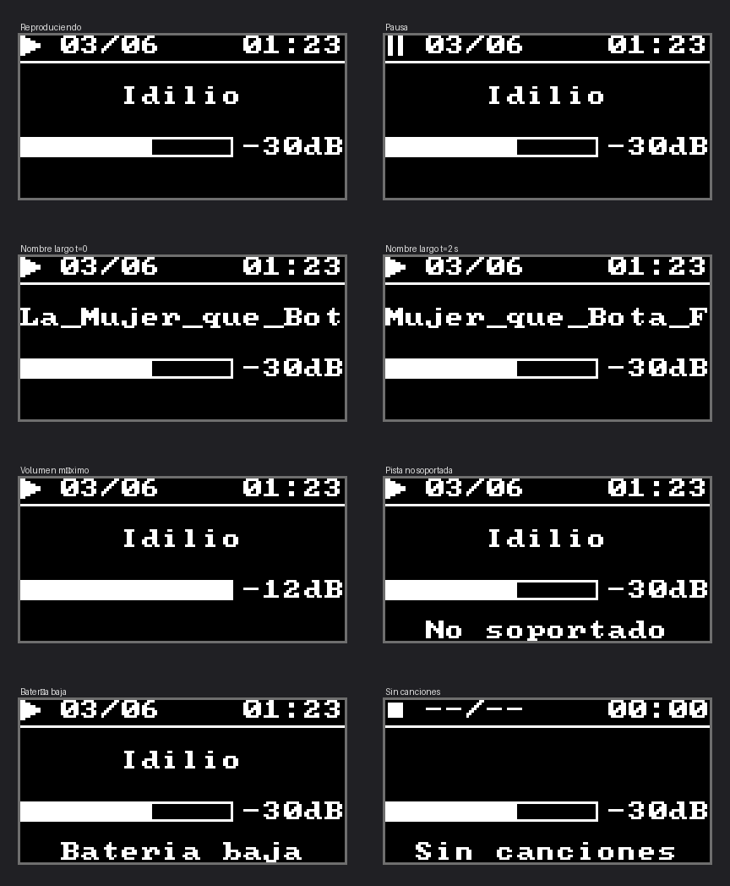
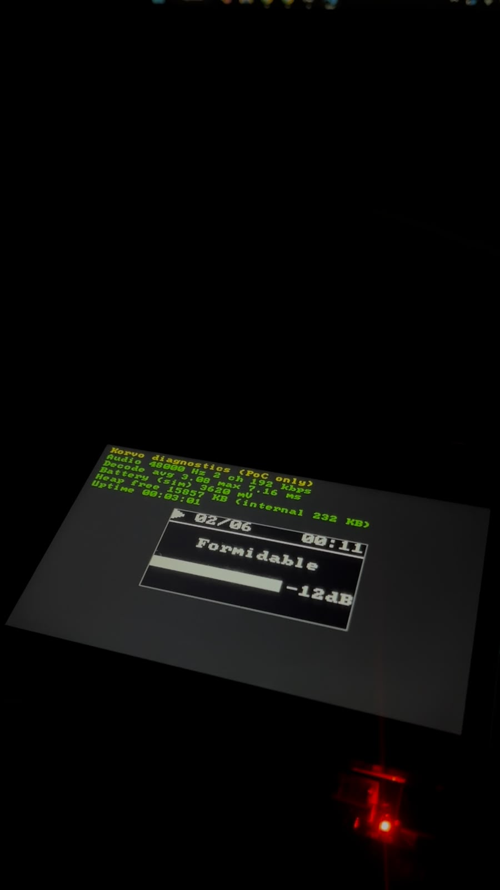

# Estado de la PoC ESP32-S31-Korvo-1

## Evidencia en video

3 videos de pruebas en la ESP32-S31-Korvo-1 grabados por el responsable: [enlace público](https://drive.google.com/drive/folders/17f_VWlQ8yTDR5UOtKaLUpxXInd0uO0in?usp=drive_link) · [enlace institucional](https://drive.google.com/drive/folders/1Tq-jJcRcQZm7ZzIBcm1W4Nzm8Wph00uq?usp=sharing) (requiere cuenta @unal.edu.co)

## Resumen de resultados

| Etapa | Qué se validó | Resultado | Detalle |
|---|---|---|---|
| E1 | Montaje de la microSD y catálogo de `MUSIC` (escenarios SD-01 a SD-07) | PASS en placa (SD-08 aplazada) | [E1](#e1--almacenamiento-microsd-registro-de-la-etapa) y [SD_VALIDATION.md](SD_VALIDATION.md) |
| E2 | Regresión de almacenamiento y tono por la ruta de audio del BSP | PASS en placa | [E2](#e2--salida-de-audio-ruta-bsp) |
| E3 | Reproducción WAV de 16 bits desde la microSD | PASS en placa | [E3](#e3--reproducción-wav-desde-microsd-ruta-bsp) |
| E4 | Reproducción MP3 con minimp3 (8, 16, 44.1 y 48 kHz) | PASS en placa | [E4](#e4--reproducción-mp3-con-minimp3-ruta-bsp) |
| E5/E7 | Reproductor con botones, volumen con tope y corte por batería simulada | PASS en placa | [E5/E7](#e5e7--reproductor-con-catálogo-botones-y-corte-por-batería-simulado) |
| E6/E8 | Interfaz de 128×64 (OLED virtual) y apagado de pantalla | PASS en placa | [E6/E8](#e6e8--interfaz-oled-virtual-128x64-y-ahorro-de-energía) |

Esta PoC valida el firmware (lógica, formatos, tiempos y protocolos) en la ESP32-S31-Korvo-1. **No valida la electrónica de la PCB Rev A**, que aún no está fabricada. Las secciones siguientes conservan el registro de cada etapa en orden cronológico.

## E1 — Almacenamiento microSD (registro de la etapa)

### Alcance de E1

Esta etapa valida el montaje microSD y el inventario inmediato de archivos MP3 en `MUSIC` mediante el BSP de la Korvo. En esa etapa todavía no se implementaba la reproducción (llegó en E3 y E4). El hardware de prueba usa ESP32-S31, ES8389 y SDMMC; el producto objetivo ESP32-S3, DAC PCM5102A + amplificador de audífonos TPA6138A2 y microSD SPI requiere validación independiente.

El catálogo portable acepta `.mp3` sin distinguir mayúsculas ASCII, ignora directorios y otros archivos, comprueba el acceso de lectura, ordena determinísticamente y admite 256 entradas con nombres de hasta 255 bytes. Ese máximo del catálogo se mide en bytes; `FATFS_MAX_LFN=255` es el límite de caracteres configurado en FATFS y no amplía el búfer del catálogo.

### Evidencia separada por tipo

#### Pruebas host anteriores

Las pruebas host compilan `music_catalog.c` con GCC C11 y un shim de `esp_err.h`. Cubren `MUSIC` inexistente o no-directorio, directorio vacío, extensiones `.mp3` mixtas, archivos ajenos, subdirectorios, ordenamiento, nombre largo, capacidad 256 y rechazo de 257. En esta actualización se añade una falla inyectada de `opendir()` después de que `stat()` confirmó el directorio. Verificación actual: GCC C11 con `-Wall -Wextra -Werror`; resultado `music_catalog tests passed`.

#### Compilaciones ESP-IDF anteriores

Se conserva como antecedente la compilación registrada de ESP-IDF 6.1 en modo preview, target `esp32s31`, BSP `espressif/esp32_s31_korvo_1` 1.0.1 y GCC RISC-V 15.2.0: 2153/2153 pasos, binario de aplicación de 319360 bytes (`0x4df80`) y aproximadamente 70 % libre en la partición de aplicación. Es evidencia histórica, no una compilación posterior a los cambios de esta actualización.

#### Pruebas físicas sobre la placa

El usuario ejecutó el firmware en una ESP32-S31-Korvo-1 V1.1 con microSD insertada. El registro entregado confirma montaje en `/sdcard`, directorio `MUSIC` detectado y tres archivos MP3 listados alfabéticamente. Se conserva el fragmento original:

```text
I (285) main_task: Calling app_main()
[PLAYER] Starting...
[PLATFORM] ESP32-S31-Korvo-1
W (285) ESP32-S31-Korvo-1: Warning: Long filenames on SD card are disabled in menuconfig!
I (295) SD_HOST: src_freq_hz: 500000000
[SD] Mounted successfully at /sdcard
[MUSIC] Directory found
[MUSIC] Tracks: 3
[TRACK 001] Baby_Im_Yours.mp3
[TRACK 002] Formidable.mp3
[TRACK 003] Idilio.mp3
[PLAYER] Ready
I (345) main_task: Returned from app_main()
```

Esto valida SD-01 para ese caso concreto. También se recibieron resultados posteriores del usuario para SD-02 a SD-07. SD-02 (MUSIC vacía), SD-03 (MUSIC ausente) y SD-04 (sin microSD, error `ESP_ERR_TIMEOUT`) se reportaron como PASS. Para SD-05 y SD-06 el usuario confirma el contenido preparado (archivos `.txt` y subdirectorios) y que el catálogo solo mostró MP3 válidos del directorio principal; son PASS por confirmación física del usuario, aunque el UART equivalente al de SD-01 no muestra por sí mismo qué entradas se excluyeron. Para SD-07 se reportó que el UART presentó completo `La_Mujer_que_Bota_Fuego_nombre_mas_largo.mp3`, por lo que el resultado funcional es PASS. No se encontró en el checkout `Pruebas PoC.md` ni los logs adicionales; se distingue aquí la confirmación del usuario de la evidencia UART disponible.

SD-08 (extensiones `.mp3`, `.MP3`, `.Mp3`) queda aplazada por decisión del responsable del proyecto; no es PASS físico. La comparación case-insensitive tiene cobertura host. La advertencia de nombres largos está presente en el primer log. No se dispone del log de la ejecución SD-07 posterior para confirmar si la advertencia desapareció; esto queda como verificación pendiente y no invalida el resultado funcional del nombre largo reportado.

#### Verificación de configuración LFN para este cambio

Se inspeccionó `C:\Espressif\v6.1\esp-idf\components\fatfs\Kconfig` de la instalación ESP-IDF 6.1. Allí `FATFS_LFN_HEAP` es una opción oficial de `FATFS_LONG_FILENAMES` («Long filename buffer in heap»). `FATFS_MAX_LFN` depende de que LFN no esté deshabilitado, tiene rango 12–255 y valor predeterminado 255. `sdkconfig.defaults` mantiene el target `CONFIG_IDF_TARGET="esp32s31"` y fija heap y 255. La configuración efectiva disponible en `sdkconfig` y `build_hw_sd/config/sdkconfig.h` también muestra `CONFIG_FATFS_LFN_HEAP=y` y `CONFIG_FATFS_MAX_LFN=255`. La configuración generada confirma esas opciones, pero no se pudo asociar al firmware de la ejecución SD-07 ni comprobar si la advertencia desapareció.

#### Compilación de firmware en esa etapa

En el momento de E1 no se pudo iniciar un build nuevo (resuelto después: ver Estado y límites). La activación de la instalación local ESP-IDF 6.1 falla antes de CMake porque falta la herramienta `esp-clangd` (`Tool esp-clangd not found`, WinError 2). No se instaló ni modificó ninguna herramienta global. Por tanto, los valores de `sdkconfig.defaults` se contrastaron con el Kconfig instalado, pero aún no se verificó el `sdkconfig` resultante de un build limpio ni se generó firmware actualizado.

#### Pruebas físicas pendientes en esa etapa

La matriz y los tipos de evidencia por escenario están en [SD_VALIDATION.md](SD_VALIDATION.md). El hito de almacenamiento se acepta y cierra dentro del alcance probado SD-01 a SD-07, con SD-08 expresamente aplazada y sin PASS físico. La ausencia del warning LFN en la ejecución posterior sigue pendiente de evidencia.

### Corrección del contrato del catálogo

El contrato documentado es que cualquier error deja el catálogo en cero. Antes, `directory_found` se marcaba tras `stat()` y antes de `opendir()`, con lo que el error de apertura dejaba metadatos parciales. Ahora se marca solo tras abrir correctamente. La prueba host inyecta una falla de apertura para probar el caso de forma determinista; no depende de permisos del usuario del sistema operativo.

## Estado y límites

- **Host:** pruebas ejecutadas y pasadas, incluida regresión de fallo `opendir()`.
- **ESP-IDF:** compilado con ESP-IDF 6.1 en `poc/esp32-s31-korvo-1/build_s31`, donde se compilaron y ejecutaron en placa los modos STORAGE, TONE_BSP, WAV, MP3 y PLAYER; los binarios flasheados para las pruebas de E2.2, E3, E4, E5/E7 y E6/E8 son los de `build_s31` (E6/E8 con PSRAM activada). `build_tonebsp` fue una verificación previa de compilación del commit de E2.2. Ver E2, E3, E4, E5/E7 y E6/E8.
- **Hardware:** hito aceptado dentro del alcance SD-01 a SD-07 según log o confirmación del usuario. SD-08 aplazada por decisión del responsable; no es PASS físico. El pendiente LFN de SD-07 se cierra en E2.1: el aviso es un falso positivo del BSP 1.0.1 (ver sección E2).
- No se ha demostrado extracción durante lectura, resistencia a fallas de medio ni funcionamiento del hardware final.
- **E2.1** regresión de almacenamiento: PASS (placa). **E2.2** tono por ruta BSP: PASS (placa, observación auditiva del responsable). **E3** reproducción WAV PCM 16 bits desde microSD por ruta BSP: PASS (placa, ver E3). **E4** reproducción MP3 con minimp3 desde microSD por ruta BSP: PASS (placa, ver E4); en la Korvo solo 8000, 16000, 44100 y 48000 Hz (las demás se rechazan con `ESP_ERR_NOT_SUPPORTED`). **E5/E7** reproductor con catálogo, botones y corte por batería simulado: PASS (placa, ver E5/E7). **E6/E8** interfaz en OLED virtual 128x64 y apagado de pantalla por inactividad: PASS (placa, ver E6/E8). La ruta TDM (`audio_korvo.c`, plan B) no está validada y no es necesaria: la Korvo reproduce con I2S estándar. No hay USB MSC ni Bluetooth; batería real, botones GPIO y OLED SSD1306 de la PCB no probados.

## Ruta TDM ES8389 (plan B): compila, sin prueba en placa

La inspección local confirmó ESP-IDF 6.1, BSP `espressif/esp32_s31_korvo_1` 1.0.1 y `esp_codec_dev` 1.5.11. El BSP inicializa I2S0 con `i2s_channel_init_std_mode()` y su helper `bsp_audio_codec_speaker_init()` hereda esa configuración. En el driver ES8389 local, `set_fs()` llama a `es8389_config_fmt(..., ES_I2S_NORMAL)`. Por ello el helper BSP no se usa para la prueba TDM.

ESP-IDF 6.1 ofrece `driver/i2s_tdm.h`. El adaptador local `audio_codec_new_i2s_data()` reconoce un handle TDM y al abrirlo configura reloj, total de slots, máscara y framing Philips. La API pública `esp_codec_dev_write_reg()` deja corregir el registro de formato después de `esp_codec_dev_open()`, que vuelve a seleccionar I2S normal. La prueba configura I2S0 TX en TDM PCM-short de cuatro slots de 16 bits a 16 kHz (BCLK calculado 1.024 MHz), ES8389 en DSP/PCM modo A y DAC S2P desde slot 0. Reaplica PCM-short después de `open()` porque el adaptador 1.5.11 lo cambia a framing TDM Philips. El tono se copia con amplitud reducida a los cuatro slots para que la prueba no dependa de asumir el enrutamiento de slots estéreo DAC no descrito con suficiente detalle en el BSP.

El test solo reproduce por la línea `DSDIN` (GPIO5) del DAC; no configura la entrada adicional `TDMIN` que puede multiplexarse en el pin MCLK del ES8389. Usa el códec en modo esclavo y mantiene MCLK GPIO desconectado según el BSP; el códec deriva su reloj de referencia interna de SCLK conforme a la configuración oficial local. El volumen inicial configurado es 20 % y la amplitud PCM máxima 8 % de escala completa. El driver maneja PA en GPIO7 y debe apagarlo al cerrar el dispositivo.

El firmware ofrece `CONFIG_POC_MODE_STORAGE` (predeterminado) y `CONFIG_POC_MODE_PCM`. La nueva ruta genera una senoide de 440 Hz, 16 kHz, PCM signed 16-bit, tres segundos y rampas lineales de 100 ms. El UART confirma operaciones de software y registros leídos; no puede confirmar que el tono sea audible. El código todavía necesita una compilación local con ESP-IDF y una ejecución física con altavoz antes de aceptar la ruta.

La implementación actual usa las señales del BSP (BCLK GPIO3, WS GPIO4, DOUT GPIO5; sin salida MCLK) y mantiene el canal I2S0 en READY para que `esp_codec_dev` pueda reconfigurar TDM durante `open()`. Después de abrir se fuerza/verifica el formato DSP-A del ES8389 por la interfaz pública de registros y se devuelve el canal a PCM-short antes de transmitir. Se usa un frame de cuatro slots de 16 bits; todos los slots reciben la misma muestra y el DAC S2P se selecciona en slot 0. Esta elección resuelve la discrepancia de formato entre el helper estándar del BSP/driver ES8389 y TDM, pero requiere confirmación física.

`audio_korvo.c` forma parte de `SRCS` y se compila dentro de los builds de E2.1 y E2.2 (aparece `audio_korvo.c.obj`), pero el modo `CONFIG_POC_MODE_PCM` nunca se ha ejecutado en la placa.

Nota histórica: en una sesión anterior (Codex) no se pudo iniciar la compilación porque el export de ESP-IDF 6.1 informó que faltaba `C:\Users\mateo\.espressif\python_env\idf6.1_py3.14_env\Scripts\python.exe`.

## E2 — Salida de audio (ruta BSP)

### E2.1 Regresión de almacenamiento — PASS (placa)

- Build en `poc/esp32-s31-korvo-1/build_s31`, ESP-IDF 6.1 `--preview`, target `esp32s31`: binario `0x4df80`, 70 % libre.
- Log de placa con App version `rev-a-5-g1a0203f`: SD montada, `MUSIC` con 4 pistas (incluido el nombre largo).
- LFN: el aviso "Long filenames on SD card are disabled" es un falso positivo del BSP 1.0.1. `src/bsp_storage.c` comprueba `CONFIG_FATFS_LONG_FILENAMES`, que no existe en nuestro `sdkconfig`; el `sdkconfig` tiene `CONFIG_FATFS_LFN_HEAP=y` y `CONFIG_FATFS_MAX_LFN=255`, y el nombre largo se muestra completo. Con esto se cierra el pendiente de LFN de SD-07.

### E2.2 Tono por ruta BSP — PASS (placa, observación auditiva del responsable)

- Commit `ea8a0d7`. Modo `CONFIG_POC_MODE_TONE_BSP`. Build 2156/2156 sin warnings, binario `0x4a150`, 71 % libre.
- `bsp_audio_codec_speaker_init()` + `esp_codec_dev` 1.5.11, 16 kHz, 16 bits, estéreo, 440 Hz, pico 25 %.
- Escalera de volumen 30/45/60: los tres audibles, volumen creciente, sin distorsión, clics ni pops, tono estable. Altavoz pasivo 4 Ω / 3 W en un conector de la Korvo.
- Log: "Open codec device OK", tones 1/3..3/3, "BSP tone test finished"; duración 353 ms -> 8413 ms (8,06 s) frente a 8 s esperados, coherente con un reloj I2S correcto.
- Prueba host `tone_gen_test`: OK (440 cruces por cero ascendentes en 1 s), ejecutada en Linux gcc 13.3.
- No probado: frecuencia medida con instrumento, música real, ruta PCM5102A del hardware final.
- Decisión: la ruta TDM (`audio_korvo.c`, plan B) no es necesaria por ahora; se conserva como referencia.

## E3 — Reproducción WAV desde microSD (ruta BSP)

- Commit `55fa8b4`. Modo `CONFIG_POC_MODE_WAV`, ruta en `CONFIG_POC_WAV_PATH`. Build en `build_s31`: 0 errores, 0 warnings, binario `0x66180` (60 % libre). `main` requiere `PRIV_REQUIRES esp_timer`.
- `core/wav_parser`: recorre chunks, salta `LIST`, respeta el padding de tamaños impares; acepta solo PCM 16 bits, 1–2 canales, 8–48 kHz. Pruebas host: "wav_parser tests passed" (Linux, gcc 13.3, `-Werror`). Además, los dos WAV reales de prueba dan `data_offset=78` (44 sin `LIST`): el salto de `LIST` funciona con archivos reales.
- Archivos de prueba sintéticos (no música comercial): `TEST.WAV` 44100 Hz estéreo 30 s (La 440, escala, melodía, tono 660 Hz solo izquierdo, 880 Hz solo derecho); `MONO16K.WAV` 16000 Hz mono 10 s.
- Lectura en una sola tarea, bloques de 4096 bytes, volumen fijo 45, mono duplicado a L/R.

### Resultados en placa (PASS)

| Prueba | Log | Observación |
|---|---|---|
| `TEST.WAV` | `frames=1323000 expected=1323000 elapsed=29980 ms duration=30000 ms ratio=0.999 max_read=2.9 ms` | Completo, sin cortes; La igual al de E2 |
| `MONO16K.WAV` | `frames=160000 expected=160000 elapsed=9982 ms duration=10000 ms ratio=0.998 max_read=2.9 ms` | Completo, sin cortes, misma altura que `TEST.WAV` |
| Archivo inexistente | "cannot open /sdcard/MUSIC/NOEXISTE.WAV" -> `ESP_ERR_NOT_FOUND` | Sin reinicio, altavoz en silencio |
| MP3 como WAV (`Idilio.mp3`) | "WAV header rejected: ESP_ERR_INVALID_ARG" | Sin reinicio; códec no se abre |

- Canales: con un solo altavoz se oyó el tono derecho y no el izquierdo -> el altavoz está en el canal derecho y la separación L/R es correcta.
- I2S: el log muestra "STD: TX ... slot_mode: STEREO" y el reloj se reconfigura a 44100 y 16000 Hz: la Korvo reproduce con I2S estándar por la ruta BSP; TDM no es necesario.
- Margen de lectura: 4096 bytes = 23 ms de audio a 44,1 kHz estéreo; lectura máxima 2,9 ms (~13 % del presupuesto).
- `ratio < 1` es esperado: `esp_codec_dev_write` retorna al encolar en DMA.
- No probado: retirar la tarjeta durante la reproducción, archivos de horas, música comercial, WAV de 24 bits reales (solo rechazo en host), ruta SPI/PCM5102A del hardware final.

## E4 — Reproducción MP3 con minimp3 (ruta BSP)

- minimp3 commit `6238eb8` (CC0), sin modificar; SHA-256 verificados de forma independiente. Wrapper `decoder/mp3_decoder` (salta ID3v2, resincroniza, fija formato). Tarea `mp3_play` con pila de 32 KB.
- Host (Linux, gcc 13.3, `-Werror`): "mp3_decoder tests passed"; "korvo_audio_caps tests passed". Decodificación de `TEST.MP3` y `MONO22K.MP3` frente a ffmpeg: diferencia máx 1 LSB, SNR 99,9 / 98,2 dB. minimp3 sin extensiones no recorta el retardo/relleno del codificador (~0,07 s más que ffmpeg): esperado.
- Build ESP-IDF: 0 errores, binario `0x6a940` (58 % libre).

### Resultados en placa (PASS)

| Prueba | Log | Observación |
|---|---|---|
| `TEST.MP3` 44,1 kHz estéreo 128 kbps | `frames=1151 samples=1325952 ratio=0.999 decode_avg=2.68 ms decode_max=6.00 ms stack_free_min=15612` | Sonó bien |
| `Idilio.mp3` 48 kHz 64 kbps (música real) | — | Audible >1 min sin defectos; reproducción completa no registrada |
| `Formidable.mp3` 48 kHz 64 kbps (música real, completa) | `frames=7219 elapsed=173240 ms duration=173256 ms ratio=1.000 decode_avg=2.82 ms decode_max=6.81 ms skipped=0 stack_free_min=15612` | Completa |
| `MONO22K.MP3` 22,05 kHz mono | — | Antes del arreglo: burbujeo audible; después: `ESP_ERR_NOT_SUPPORTED`, códec no se abre, sin reinicio |

- Margen: `decode_max` (incluye lectura SD) 6,81 ms frente a 24–26 ms por frame; ~12 % CPU promedio. Pila: ~17 KB usados de 32 KB.

### Diagnóstico 22050 Hz

- `MONO22.WAV` (sin MP3) también burbujea -> no es el decodificador.
- Causa en esp_codec_dev 1.5.11: sin MCLK, `es8389_config_sample()` usa `mclk = fs*16*4` y no hay fila (ratio 64) para 22050; `es8389_set_fs()` ignora el error y `open()` devuelve OK con divisores de reloj previos.
- Frecuencias válidas en la Korvo: 8000, 16000, 44100, 48000. `korvo_audio_caps` rechaza las demás. Es una limitación de la Korvo; el PCM5102A de la PCB autodetecta fs.
- Observación: el `ESP_LOGE` "Unable to configure sample rate" del driver no se vio en el log de 22050 Hz (no investigado).

### No probado en placa

Regresión de `TEST.MP3` tras el arreglo (cubierta por la prueba host de la lista); archivo no-MP3 en modo MP3; MP3 VBR, MPEG-2.5, archivos dañados, retirar la tarjeta durante la reproducción.

## E5/E7 — Reproductor con catálogo, botones y corte por batería simulado

- Commits `f238764` (implementación) y `984ca1c`, que eliminó el placeholder `main/player_core.h`: sombreaba a `core/player_core.h` desde `main/` y causó el primer fallo de build. Las pruebas host no lo detectaron porque solo incluían `main/core`.
- Arquitectura: tarea `player` (8 KB) con cola de eventos. Productores: botones (`bsp_iot_button_create`, espressif/button 4.2.2, escalera ADC), motor de audio y temporizador de batería. `core/player_core` decide; la tarea `audio_engine` (32 KB) ejecuta OPEN/PAUSE/RESUME/CLOSE/RESTART/SET_VOLUME/SHUTDOWN entre frames. Un contador `gen` descarta eventos de pistas ya abandonadas.
- Botones: SET corto = play/pausa; SET largo = batería simulada; MODE corto = siguiente; MODE largo = anterior; VOL+/VOL-.
- Volumen: el core trabaja en dB (-60..-12, paso 2, inicio -30); en la Korvo, lineal -60 dB -> 0 %, -12 dB -> 60 % (`korvo_volume`).
- Host: "korvo_volume tests passed"; `battery_sim`: LOW_BATTERY en el tick 15 (3400 mV), una sola vez.

### Resultados en placa (PASS, log + observación del responsable)

- Catálogo de 6 pistas y arranque automático a -30 dB / 38 %.
- NEXT con vuelta 6 -> 1.
- `MONO22K.MP3` saltada con `ESP_ERR_NOT_SUPPORTED`.
- Cambio 48 / 44,1 / 48 kHz con reapertura del códec.
- PREV a 4776 y 11376 ms reinicia la pista; a 2016 ms va a la pista anterior.
- Pulsaciones largas sin disparar la corta.
- 2 ciclos de pausa sin zumbido ni pop.
- Volumen hasta -12 dB / 60 %.
- Batería simulada 3700 -> 3400 mV, LOW_BATTERY, "shutdown: file and codec closed", "orderly shutdown complete" (coincide con la predicción host).

### Avisos y límites

- "i2s_channel_disable: the channel has not been enabled yet" al cambiar de frecuencia: benigno, la reapertura funciona.
- Pila de la tarea `player` no medida (sin desbordamiento observado).
- Saturación del volumen verificada en host.
- En la Korvo la etapa AMP del anti-pop es no-op y no hay corte real de alimentación.
- Batería real (BAT_ADC, IO1) y botones GPIO de la PCB no probados.

## E6/E8 — Interfaz (OLED virtual 128x64) y ahorro de energía

- Commit `fc9fce8`. Framebuffer portable 128x64 de 1 bit con layout SSD1306 (`core/ui_render`, `core/ui_model`, fuente font8x8 de dominio público, commit `8e279d2`). En la Korvo se muestra ampliado x3 en la LCD 800x480 RGB565 (`bsp_display_new` + `esp_lcd_panel_draw_bitmap` por franjas, solo páginas cambiadas), blanco sobre negro, más un panel de diagnóstico a color solo-Korvo.
- Host: "ui_model tests passed" (Linux gcc 13.3 y MSYS2); `ui_preview` generó 8 pantallas revisadas antes de flashear.
- PSRAM: requerida por el framebuffer RGB (768 KB). Configuración: `SPIRAM=y`, modo octal; velocidad 200 MHz (por defecto). Log: "Found 16MB PSRAM device", "Speed: 200MHz", "SPI SRAM memory test OK". XIP/RODATA desde PSRAM no habilitados.

### Resultados en placa (PASS, log + observación del responsable)

- OLED virtual igual a las previsualizaciones.
- Nombre largo con desplazamiento fluido; el tiempo avanza cada segundo.
- Panel de diagnóstico con datos.
- Sin cortes de audio durante los redibujos; respuesta inmediata a botones.
- "No soportado" al saltar `MONO22K.MP3`.
- E8: pantalla "apagada" tras 10 s sin botones; el primer botón solo despierta ("wake (button press discarded)"); los mensajes despiertan la pantalla.
- Batería baja: el audio se apaga primero (shutdown del motor) y después "Bateria baja" -> "Apagando..." -> pantalla en negro; verificado también con la pantalla previamente apagada.
- El panel de diagnóstico muestra el bitrate del frame actual: `Formidable.mp3` mostró 192 kbps en la foto frente a 64 kbps del primer frame en el log de E4, coherente con un archivo VBR (no verificado).
- La foto muestra decode avg 3,08 ms / max 7,16 ms con la UI activa (E4 sin UI: 2,82 / 6,81 ms).



*Previsualización generada en el PC (host) con el mismo código de ui_model/ui_render que corre en la placa; no es una fotografía. Las 8 pantallas son las verificadas antes de flashear.*



*Fotograma de un video de la prueba en la ESP32-S31-Korvo-1 (OLED virtual en la LCD).*

### Límites

- En la Korvo la retroiluminación no es controlable (`BSP_LCD_BACKLIGHT` = NC), así que el apagado es solo visual (sin ahorro real); en una OLED los píxeles apagados sí ahorran. Consumo no medido.
- Pila de la tarea `ui` no medida (sin desbordamiento observado).
- La UI muestra los guiones bajos del nombre de archivo tal cual.

Evidencia adicional: el responsable grabó videos de las pruebas (ver [Evidencia en video](#evidencia-en-video)).

## Trabajo futuro

- Modo carga por WiFi (subir MP3 a la microSD desde un navegador), activado solo bajo demanda; portable al ESP32-S3 sin cambios de hardware. No implementado.

## Próxima acción

Firmware para la PCB Rev A: capa de placa ESP32-S3 (SD por SPI, PCM5102A por I2S con XSMT/AMP_MUTE_N, botones GPIO con antirrebote, BAT_ADC).
